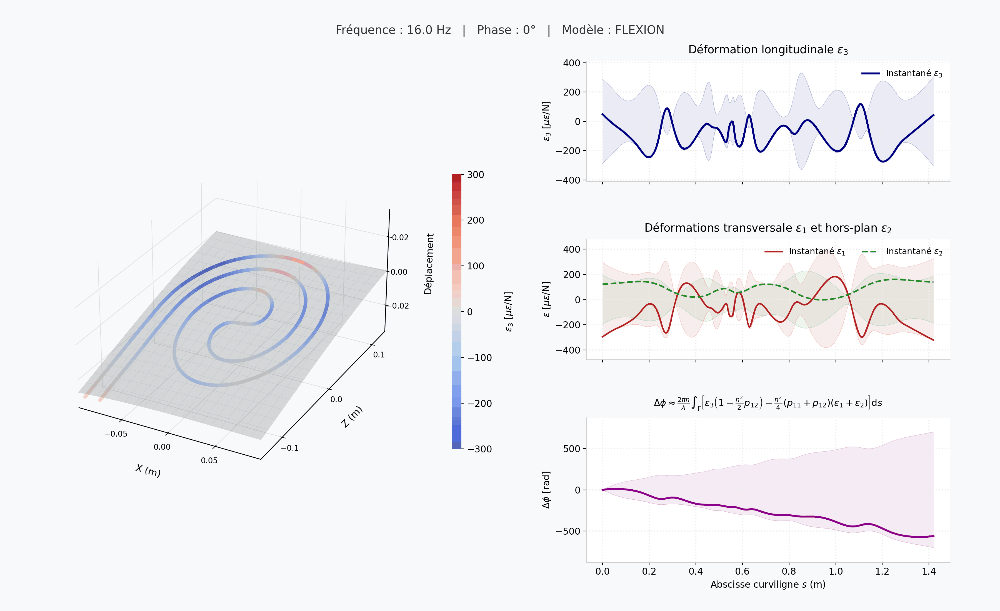

# Optimisation vibratoire d'un interféromètre à fibre optique

Animation de la réponse d'une plaque vibrant à 58 Hz, instrumentée d'une fibre optique collée en spirale. La couleur de la fibre indique la déformation longitudinale ε₃ ; le graphique de droite montre la phase optique cumulée Δφ le long de la fibre.

**Auteurs** : E. Breton, C. Desjouy, P. O'Donoughue, C. Pezerat, A. Pelat, P. Brochard

Laboratoire d'Acoustique de l'Université du Mans (LAUM) · Silentsys, Le Mans

*Poster présenté aux JJCAB 2026, Compiègne.*

Contact : eliott.breton@univ-lemans.fr
